<div align="center">

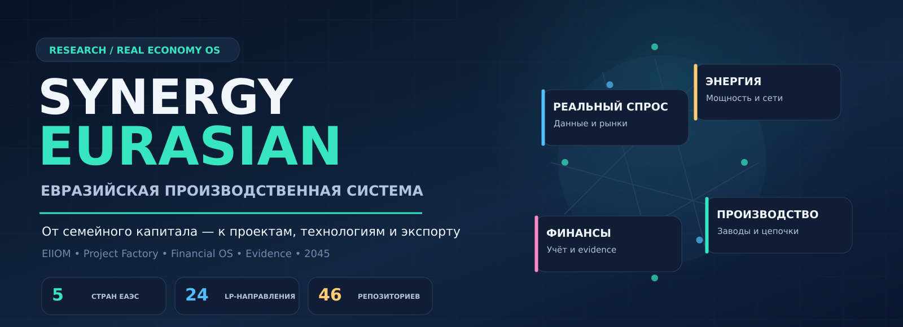

<br />

**Евразийская интеллектуально-производственная система**

От наблюдаемого спроса и семейного капитала — к энергии, материалам, технологиям, предприятиям, экспорту и проверяемым денежным результатам.

<br />


[Архитектура](#архитектура-системы) · [Страны ЕАЭС](#пять-стран-одна-производственная-сеть) · [EIIOM](#оптимизатор-eiiom-экономический-компилятор) · [Project Factory](#project-factory-проектный-конвейер) · [Финансы](#финансовая-архитектура-и-капитал) · [Доказательность](#научный-статус-и-границы-достоверности) · [Запуск](#быстрый-запуск)

</div>

> **Статус проекта.** EIIOM-v2 — исполняемый исследовательский LP-оптимизатор. EIIOM-v4 — подробно определённая архитектура пространственной стохастической оптимизации, для которой ещё требуются данные, реализация и независимые испытания. Численные результаты ниже относятся к **сценарию**, а не к построенным активам, привлечённым инвестициям или заработанной прибыли.

---

## Что такое SYNERGY EURASIAN

**SYNERGY EURASIAN / Real Economy OS** — исследовательская архитектура экономического планирования и проектного управления в пространстве пяти стран ЕАЭС: **России, Казахстана, Беларуси, Армении и Кыргызстана**. Система задумывается как связующее звено между спросом, реальными ресурсами, производственными цепочками, инвестиционными решениями, подтверждёнными результатами и повторным накоплением капитала.

Её задача — не объявить отдельные отрасли приоритетными, а вычислить, **какие проекты, в каком месте, в какой последовательности и при каких ограничениях** могут создавать проверяемый экономический результат. Подход объединяет промышленную и инфраструктурную экономику, вычислительные мощности, агробиотехнологии, цифровые сервисы, кадровый потенциал и финансовую дисциплину.

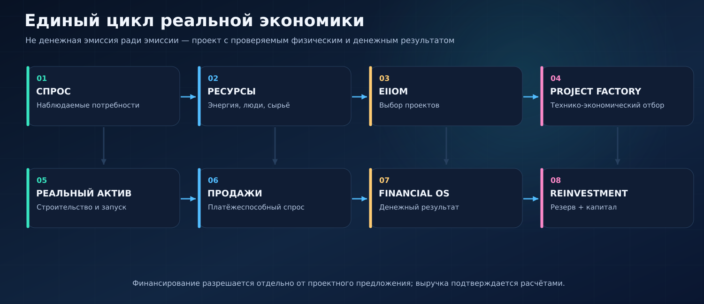

### Четыре масштаба одного проекта

| Масштаб | Цель | Что учитывается |
|:--|:--|:--|
| **L0 · Человек и семья** | Финансовая устойчивость и рост человеческого капитала | Доход, расходы, долги, резерв, образование, добровольные инвестиции |
| **L1 · Предприятие и проект** | Экономически жизнеспособная деятельность | Покупатели, мощности, себестоимость, CAPEX, OPEX, денежный поток |
| **L2 · Регион и кластер** | Развитие связанных производственных цепочек | Электросети, вода, кадры, жильё, логистика, поставщики |
| **L3 · ЕАЭС и внешний рынок** | Кооперация и внешняя покупательная способность | Международная торговля, FX, экспорт, коридоры, санкционные и правовые ограничения |

Подробно: [контекст и цели](docs/00_CONTEXT_AND_VISION.md) · [архитектура](docs/01_SYSTEM_ARCHITECTURE.md) · [Grand Strategy 2045](docs/36_GRAND_STRATEGY_2045.md).

---

## Архитектура системы

Центр EURASIAN — **EIIOM (Eurasian Intelligent Industrial Optimization Model)**, который получает наблюдаемые факты и проектные предложения, строит варианты инвестирования и передаёт их на отдельные стадии проверок. Он **не авторизует денежную эмиссию, платежи или ценные бумаги**.

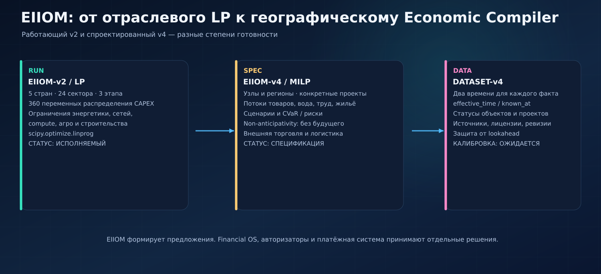

**Архитектурное разделение полномочий:**

```text
Наблюдаемый спрос + реальные ресурсы + проекты + ограничения
                         │
                         ▼
                  EIIOM / Real Economy OS
             ProjectProposal + physical evidence
                         │
                         ▼
             Технический и экономический аудит
                         │
                         ▼
                  Financial OS
        CapitalAuthorization / лимиты и учёт
                         │
                         ▼
                 Payment / Settlement
                SettlementReceipt
                         │
                         ▼
              Независимые EvidencePackage
                         │
                         ▼
             Реальные активы + продажи + HardNAV
```

Интерфейсы закреплены в [`interfaces/`](interfaces), включая [`project_proposal.schema.json`](interfaces/project_proposal.schema.json), [`resource_state.schema.json`](interfaces/resource_state.schema.json), [`demand_signal.schema.json`](interfaces/demand_signal.schema.json) и [`evidence_package.schema.json`](interfaces/evidence_package.schema.json). Ролевое распределение всей экосистемы — в [`config/federation_v4.json`](config/federation_v4.json).

---

## Пять стран — одна производственная сеть

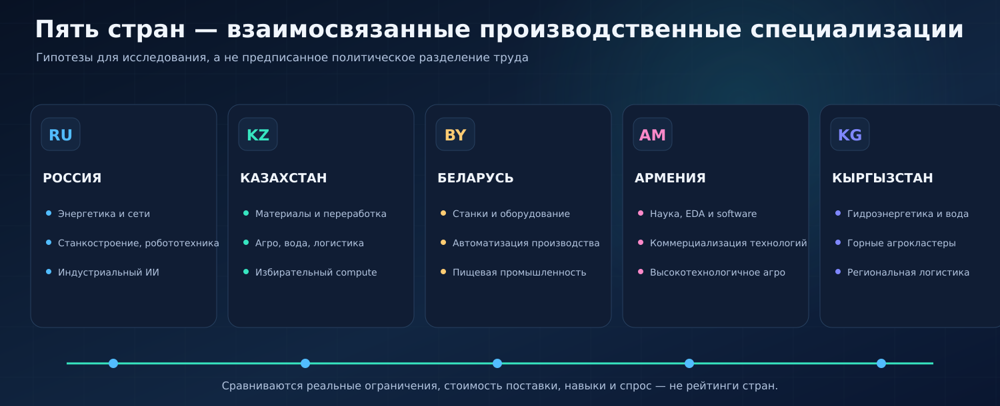

Система должна выявлять наиболее жизнеспособное размещение предприятий с учётом фактических ставок, кадров, материалов, энергообеспечения, таможенных и логистических издержек. Страновые специализации — **гипотезы**, а не жёстко заданная модель разделения труда.

**Пример:** переработка сырья в Казахстане может быть связана с оборудованием из Беларуси, энергетикой и промышленным спросом России, инженерными решениями из Армении и транзитными маршрутами Кыргызстана. Выбор такой цепочки требует доказательств качества, цены, логистики и реального покупателя; географическая близость сама по себе не означает рентабельность.

Документы: [экономическая карта](docs/18_EURASIAN_GEOECONOMIC_GRID.md) · [страновые портфели](docs/37_COUNTRY_PORTFOLIOS.md) · [статистическая база](docs/27_REALITY_BASELINE_2026.md).

---

## Семь промышленных суперцепочек

В экономике важна не отдельная фабрика, а её **роль в целой системе ресурсов, оборудования, услуг и конечного спроса**. Электростанция без сети, завод без инженеров, ЦОД без контрактных нагрузок, агропроизводство без хранилищ или логистики — потенциально недоиспользованный капитал.

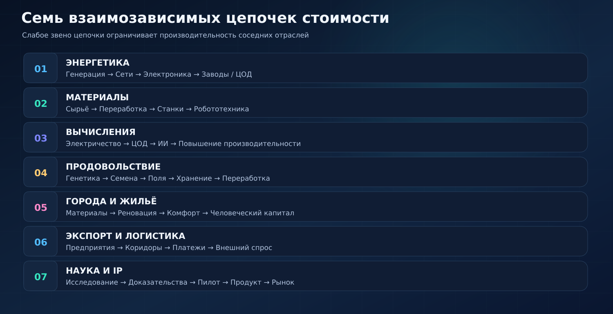

**Полная отраслево-производственная карта** содержит 35 направлений: энергетика и сети, критические и специальные материалы, станки, робототехника, промышленный ИИ, дата-центры, электроника, агрогенетика, сельское хозяйство, водные системы, городское обновление, логистика, научная коммерциализация, оборотный капитал малого бизнеса и другие. Это не означает, что по всем направлениям уже существуют предприятия или готовые оптимизационные модели.

См. [35 производственных направлений](docs/26_SECTOR_AND_VALUE_CHAIN_MASTER_MAP.md) и [архетипы проектов](docs/12_PROJECT_ARCHETYPES.md).

---

## Оптимизатор EIIOM: экономический компилятор

### EIIOM-v2 — воспроизводимый линейный оптимизатор

Исполняемая реализация [`src/eiiom_optimizer.py`](src/eiiom_optimizer.py) использует `scipy.optimize.linprog` и набор жёстких ограничений. Рассматриваются **5 стран × 24 отрасли × 3 временных этапа = 360 переменных распределения капитала**.

В модели учитываются бюджет по этапам, лимиты концентрации, энергетика, передача мощности, ЦОД и compute, цепочки отдельных промышленных технологий, сельскохозяйственные и жилищные целевые показатели. Величины по странам и секторам из [`config/base_scenario.json`](config/base_scenario.json) являются **исследовательскими коэффициентами**, если отдельно не приведён внешний источник.

### BASE-v2 — пример расчётного сценария

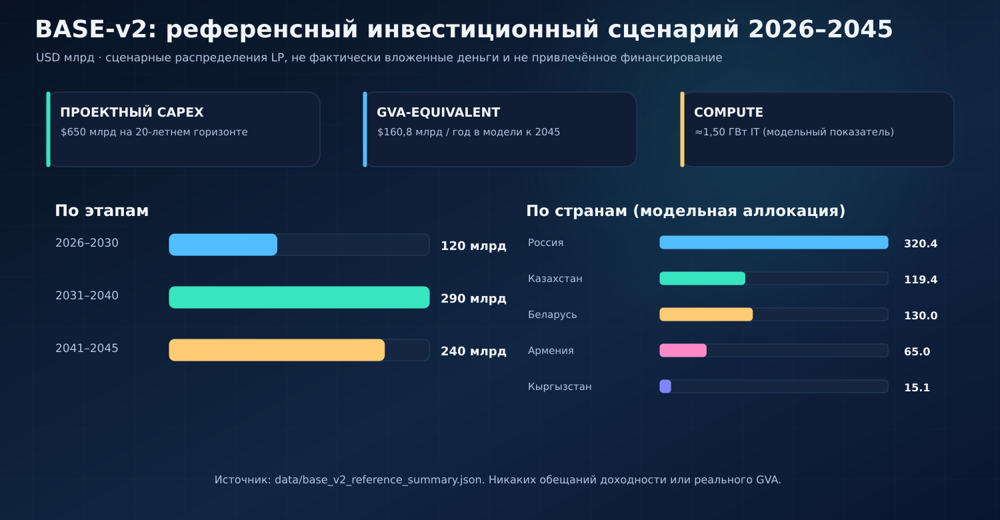

| Показатель модели | Референсное значение | Значение показателя |
|:--|--:|:--|
| Суммарный плановый CAPEX 2026–2045 | **$650 млрд** | Сценарный бюджет, **не привлечённые инвестиции** |
| 2026–2030 / 2031–2040 / 2041–2045 | $120 / $290 / $240 млрд | Сценарное распределение |
| Годовой *GVA-equivalent* в 2045 | **$160,8 млрд/год** | Целевая функция / модельный эквивалент, **не официальный ВВП** |
| Модельный compute IT | ≈1 496 МВт | Не существующие мощности проекта |
| Модернизация городской недвижимости | 100 млн м² | Заложенный сценарный ориентир |
| Точное земледелие | 60 млн га | Заложенный сценарный ориентир |
| Rural AI clusters | 160 | Заложенный сценарный ориентир |

Источник приведённых сценарных величин: [`data/base_v2_reference_summary.json`](data/base_v2_reference_summary.json). Они **не являются прогнозом гарантированной доходности, активами на балансе, выручкой или реализованной добавленной стоимостью**.

### EIIOM-v4 — следующий класс задачи

[`EIIOM-v4 Stochastic Spatial MILP`](docs/23_EIIOM_V4_STOCHASTIC_MILP.md) должен принимать решения о запуске конкретных объектов, расширении мощностей и движении товаров в пространстве с учётом сценариев будущего, риска, задержек строительства, технических зависимостей и неполной информации.

Основные обозначения:

```text
BUILD[p,t]      — решение запустить проект p к моменту t
CAPADD[p,t]     — прирост доступной производственной мощности
FLOW[k,e,t,ω]   — движение товара k по маршруту e при сценарии ω
PROD[p,k,t,ω]   — физический выпуск предприятия
INV[k,n,t,ω]    — запасы на физическом узле
HH_INVEST[h,p,t] — допустимые инвестиции семей
```

Ключевые уравнения:

```text
Производство + Импорт + Входящие поставки + Складской запас
 = Промежуточное использование + Потребление + Экспорт
 + Исходящие поставки + Остаток + Потери

Потребность в ресурсе[i,p] ≥ Норма[i,p] × Выпуск[p]
Выпуск[p] ≤ Доступная мощность[p] × Фактическая доступность[p]
```

> **Степень готовности:** EIIOM-v4 описан как спецификация, но общий калиброванный пространственный MILP и реальные результаты на индустриальной сети **пока не подтверждены**. Отдельно требуется реализовать non-anticipativity: агент не может знать информацию, ещё не доступную в момент решения.

---

## Project Factory: проектный конвейер

Модель создания крупных экономических активов начинается с отсева неподтверждённых идей, а не с максимизации выдачи кредита. Из 1 000 потенциальных инициатив зрелая проектная фабрика *планирует* получать 20–30 решений об инвестиционной готовности за год. Это **проектное целевое значение**, не операционная статистика.

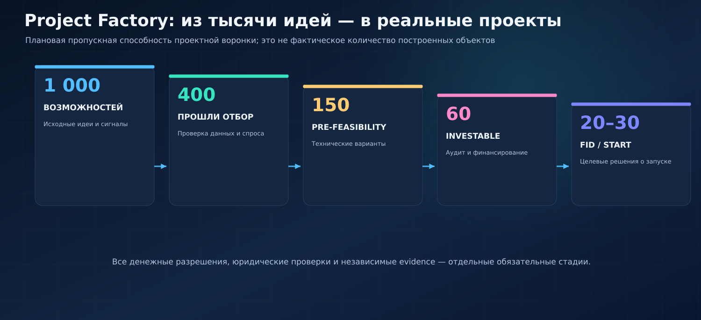

У каждого проекта нужен цифровой паспорт, включая спрос, конкурентов, мощности, воду, электроэнергию, разрешения, землю, кадры, CAPEX/OPEX, сроки, покупателей, кредитные условия, источники подтверждения и сценарии провала. После проверки проект может быть передан в финансовый контур — **но не автоматически профинансирован**.

Источники: [Project Factory 1000](docs/29_PROJECT_FACTORY_1000.md) · [архетипы проектов](docs/12_PROJECT_ARCHETYPES.md) · [риски и комплаенс](docs/08_GOVERNANCE_RISK_COMPLIANCE.md).

---

## Финансовая архитектура и капитал

Основная идея — **Delta**: свободный подтверждённый финансовый ресурс после реальных расходов и обязательств. Она проявляется на уровне семьи, фирмы, проекта, региона и трансграничной системы. У этих уровней разные бухгалтерские смыслы — **переводы между ними нельзя суммировать как новую общественную прибыль**.

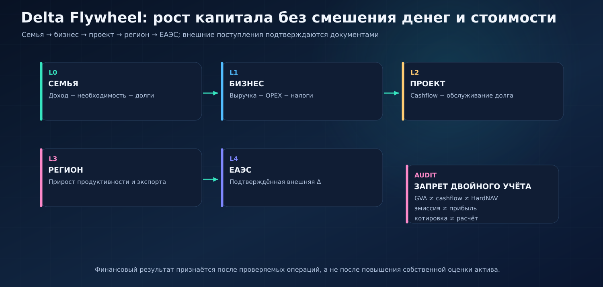

### Защита капитала семьи

Сначала необходимые расходы и резерв на непредвиденные обстоятельства. Затем — диверсифицированные сбережения. Долгосрочное участие в проектах допускается только из доступного риск-бюджета и с учётом сроков, ликвидности и законодательства.

### Резервирование, productive escrow и эмиссия

В EURASIAN **продуктивная эскроу-эмиссия описана как интерфейс и политика**, но **не реализована в данном репозитории как платёжное или эмиссионное ядро**. Подтверждение проекта не является разрешением на создание денег. Система должна направлять доказательства в Financial OS, а тот — независимо учитывать обязательства, залог, нормативные ограничения и разрешённые транши.

```text
ProjectProposal → техническая проверка → EvidencePackage
                                            ↓
                                Financial OS / Risk Gate
                                            ↓
                                    CapitalAuthorization
                                            ↓
                                  Payment / Settlement
                                            ↓
                                Фактическая закупка актива
```

**Правила:** `эмиссия ≠ прибыль`, `капитализация собственного токена ≠ HardNAV`, `внутренний арбитраж ≠ внешняя выручка`, `денежное обещание ≠ фактическое поступление`.

**Соседние проекты:** [synergy_financial_os](https://github.com/Shtenco/synergy_financial_os) · [synergy_pay_system](https://github.com/Shtenco/synergy_pay_system) · [synergy_ai_economy](https://github.com/Shtenco/synergy_ai_economy) · [synergy_system](https://github.com/Shtenco/synergy_system).

Подробно: [народный капитал](docs/06_PEOPLES_CAPITAL_DELTA.md) · [P2P и взаимный кредит](docs/19_P2P_MUTUAL_CREDIT_AND_CAPITAL.md) · [капитальный маховик](docs/20_MULTI_SCALE_CAPITAL_FLYWHEEL.md) · [финансовые рынки](docs/24_EURASIAN_FINANCIAL_MARKET_AND_SETTLEMENT.md).

---

## Федерация технологий SYNERGY

EURASIAN задумывается не как монолит: спрос может приходить от Business OS, научные технологии — из NEXUS, расчётные разрешения — из Financial OS, платёжные подтверждения — из MetaPay. Каждая подсистема имеет чётко описанные **права на факты и действия**.

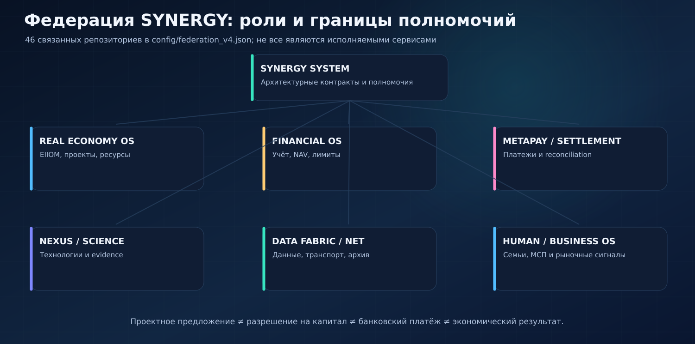

В [`config/federation_v4.json`](config/federation_v4.json) перечислены **46 репозиториев** с ролями. Наличие в реестре **не доказывает**, что 46 сервисов развернуты, интегрированы или имеют подтверждённую промышленную эффективность. Там, где полномочия отсутствуют, они явно не подразумеваются.

См. [карта федерации](docs/17_FEDERATION_46_SYSTEM_MAP.md), [архитектура](docs/01_SYSTEM_ARCHITECTURE.md), [интерфейсы](interfaces/) и [инфраструктура](docs/21_EURASIAN_DIGITAL_INFRASTRUCTURE.md).

---

## Control Tower: не один показатель успеха

Главная аналитическая панель EURASIAN должна измерять **не одну модельную добавленную стоимость, а причинные механизмы экономического развития**: реальные мощности, спрос, доходы домохозяйств, занятость, инвестиции, инфляционные и бюджетные риски, внешний оборот и подтверждённые денежные потоки.

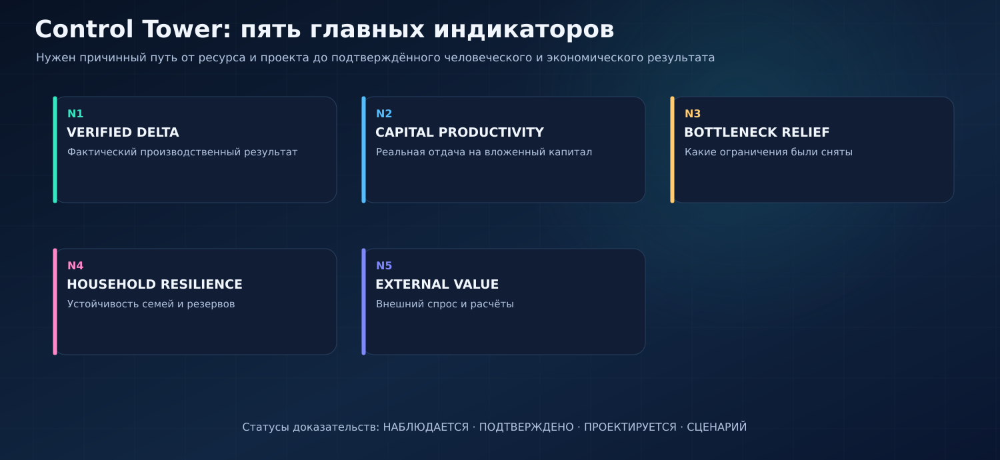

| Уровень | Обязательные метрики |
|:--|:--|
| **Реальная экономика** | Выпуск и ВДС, производительность, загрузка мощностей, локализация, энергия на единицу продукции |
| **Домохозяйства** | Медианный реальный доход, расходы, резерв, долговая нагрузка, благосостояние, доступность жилья |
| **Компании и проекты** | Выручка, OPEX, CAPEX, DSCR, просрочка, сроки строительства, доля МСП в поставках |
| **ЕАЭС** | Взаимная торговля, экспортная выручка, узкие места коридоров, критический импорт, FX-экспозиция |
| **Государство** | Налоги, бюджет, госдолг, расходы на инфраструктуру, социальные результаты |
| **Банковская система** | Ликвидность, капитал, кредитные потери, долгосрочные обязательства, динамика денег и ставок |
| **Наука и технология** | TRL, число воспроизведённых пилотов, патенты, фактическая отдача внедрения |

Источник KPI: [`docs/30_CONTROL_TOWER_AND_KPI.md`](docs/30_CONTROL_TOWER_AND_KPI.md). Панель — **спецификация измерения**, а не публичный dashboard с уже доказанными реальными KPI.

---

## Научный статус и границы достоверности

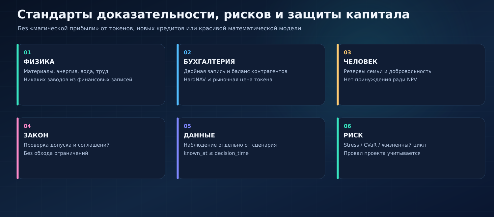

| Подсистема | Текущий проверяемый статус |
|:--|:--|
| EIIOM-v2 / SciPy LP | Исполняемый исследовательский код и тесты в репозитории |
| Референсная модель 2026–2045 | Сценарий с опубликованными параметрами и solver snapshot |
| EIIOM-v4 / пространственный MILP | Архитектурная спецификация; не готовый калиброванный runtime |
| DATASET-v4 и промышленная статистика | Схемы и план калибровки; полноценная панель ещё не собрана |
| Project Factory 1000 | Проектная воронка и операционная методология; не подтверждённый объём работ |
| Федерация 46 репозиториев | Каталог компонентов и назначенных ролей; не доказательство полной интеграции |
| Escrow / эмиссия / токенизация | Спецификация взаимодействий; не live settlement в EURASIAN |
| Реальные фабрики, резервные активы, прибыль инвесторов | Не должны заявляться без внешних независимых доказательств |

Ни один сценарный показатель, визуализация или макроэкономическая гипотеза в этом README **не является гарантией, прогнозом инвестиционного дохода, доказательством отсутствия инфляции или фактом строительства**.

### Данные без заглядывания в будущее

Для каждой записи DATASET-v4 нужны `effective_time` (время, к которому относится факт) и `known_at` (момент, когда он стал известен системе). При воспроизведении прошлого решения `known_at` не может быть позже времени принятия решения. Кроме того, статусы `OBSERVED`, `COMMITTED`, `UNDER_CONSTRUCTION`, `PLANNED`, `ANNOUNCED` и `SCENARIO` не смешиваются.

Подробнее: [DATASET-v4](docs/35_DATASET_V4.md) · [допущения и источники](docs/10_SOURCES_AND_ASSUMPTIONS.md) · [риски](docs/34_RESILIENCE_AND_STRESS_TESTING.md).

---

## Дорожная карта 2026–2045

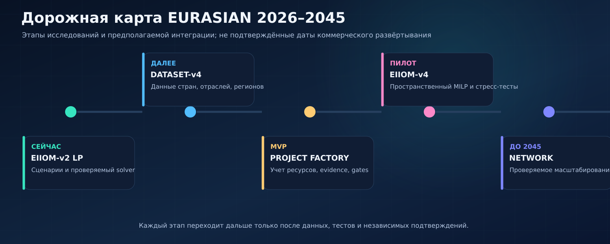

**Ближайший научный приоритет** — не нарисовать ещё больше проектных целей, а подать в оптимизатор реальные региональные физические данные, оценить ошибки сценариев и проверить портфели при дефиците ресурсов и ухудшении внешних условий.

| Этап | Что должно быть сделано | Критерий перехода |
|:--|:--|:--|
| **M0: EIIOM-v2** | Воспроизводимый LP, ограничения и тесты | Повторяемая оптимизация и проверка инвариантов |
| **M1: DATASET-v4** | Статистика стран, отраслей, предприятий, воды и энергии | Известные источники, единицы, временные срезы |
| **M2: Project Factory** | Типизированные паспорта, доказательства, стадии отбора | Устойчивое исключение непригодных проектов |
| **M3: EIIOM-v4** | Пространственный MILP с риском и supply chains | Closed OOS, сценарная устойчивость, независимая проверка |
| **M4: Федеративный пилот** | Отдельные разрешения, расчёты, отчётность | Доказанный end-to-end trace без нарушения прав |
| **2045: долгосрочная цель** | Масштабируемая кооперация и производительность | Реальные измеримые результаты, а не симуляционные цели |

Подробно: [`docs/09_ROADMAP_2026_2045.md`](docs/09_ROADMAP_2026_2045.md) · [`docs/31_V4_EXECUTION_ROADMAP.md`](docs/31_V4_EXECUTION_ROADMAP.md).

---

## Быстрый запуск

Требуются **Python 3.10+**, `numpy`, `scipy`, `pytest`, `jsonschema` (смотрите [`requirements.txt`](requirements.txt)). Команды запускаются из корня репозитория.

```bash
git clone https://github.com/Shtenco/synergy_eurasian.git
cd synergy_eurasian
python -m venv .venv

# Linux/macOS:
source .venv/bin/activate
# Windows PowerShell: .venv\Scripts\Activate.ps1

python -m pip install -r requirements.txt
python -m pytest -q
python src/eiiom_optimizer.py --config config/base_scenario.json --output outputs/base
```

В `outputs/base/` генерируются `summary.json` и `allocation.csv`. Выполнение требует правомерного доступа к исходному коду и соблюдения лицензии репозитория.

### Что смотреть после запуска

| Файл | Что в нём находится |
|:--|:--|
| [`src/eiiom_optimizer.py`](src/eiiom_optimizer.py) | Исполняемая функция оптимизации `solve` |
| [`config/base_scenario.json`](config/base_scenario.json) | Сценарные параметры, технологические кривые и ограничения |
| [`data/base_v2_reference_summary.json`](data/base_v2_reference_summary.json) | Референсная таблица результатов v2 |
| [`data/eiiom_v2_marginal_next_1bn.csv`](data/eiiom_v2_marginal_next_1bn.csv) | Предельные изменения сценарного распределения |
| [`config/scenarios_v4.json`](config/scenarios_v4.json) | Матрица стресс-сценариев для следующего поколения |
| [`tests/`](tests/) | Проверки схем, интеграционных контрактов и инвариантов |

---

## Документация и навигация по репозиторию

Репозиторий уже содержит подробную документацию — она сохранена и доступна по прямым ссылкам.

| Раздел | Где читать |
|:--|:--|
| Видение, системная архитектура | [`docs/00_CONTEXT_AND_VISION.md`](docs/00_CONTEXT_AND_VISION.md), [`docs/01_SYSTEM_ARCHITECTURE.md`](docs/01_SYSTEM_ARCHITECTURE.md) |
| Модель EIIOM, промышленность | [`docs/02_EIIOM_MODEL.md`](docs/02_EIIOM_MODEL.md), [`docs/26_SECTOR_AND_VALUE_CHAIN_MASTER_MAP.md`](docs/26_SECTOR_AND_VALUE_CHAIN_MASTER_MAP.md) |
| Сельское хозяйство, биотехнологии | [`docs/03_AI_AGRICULTURE.md`](docs/03_AI_AGRICULTURE.md) |
| Капитал, P2P, цифровые права | [`docs/04_FINANCE_AND_SYNA.md`](docs/04_FINANCE_AND_SYNA.md), [`docs/19_P2P_MUTUAL_CREDIT_AND_CAPITAL.md`](docs/19_P2P_MUTUAL_CREDIT_AND_CAPITAL.md) |
| Человек, жильё, навыки | [`docs/05_HOUSING_RENOVATION.md`](docs/05_HOUSING_RENOVATION.md), [`docs/25_HUMAN_CAPITAL_AND_SOCIAL_INFRASTRUCTURE.md`](docs/25_HUMAN_CAPITAL_AND_SOCIAL_INFRASTRUCTURE.md) |
| Пространственная оптимизация | [`docs/23_EIIOM_V4_STOCHASTIC_MILP.md`](docs/23_EIIOM_V4_STOCHASTIC_MILP.md) |
| Проектная фабрика, мониторинг | [`docs/29_PROJECT_FACTORY_1000.md`](docs/29_PROJECT_FACTORY_1000.md), [`docs/30_CONTROL_TOWER_AND_KPI.md`](docs/30_CONTROL_TOWER_AND_KPI.md) |
| Реальная статистика, ограничения | [`docs/27_REALITY_BASELINE_2026.md`](docs/27_REALITY_BASELINE_2026.md), [`docs/35_DATASET_V4.md`](docs/35_DATASET_V4.md) |
| Экономическая стратегия | [`docs/36_GRAND_STRATEGY_2045.md`](docs/36_GRAND_STRATEGY_2045.md), [`docs/37_COUNTRY_PORTFOLIOS.md`](docs/37_COUNTRY_PORTFOLIOS.md) |
| Прежняя полная версия главного README | [`docs/README_FULL_PRE_REDESIGN_2026.md`](docs/README_FULL_PRE_REDESIGN_2026.md) |
| Дизайн-ассеты | [`assets/readme/`](assets/readme/) |

---

## Авторские права и ограничения использования

**Copyright  2026 Evgeniy Koshtenko. All rights reserved.** Проект распространяется под собственной лицензией [`LICENSE`](LICENSE). Публичная доступность GitHub **не означает открытую лицензию** или разрешение на коммерческое использование. Права сторонних компонентов и уже выданные лицензии сохраняются в применимых пределах.

<p align="center"><strong>SYNERGY EURASIAN — капитал имеет смысл тогда, когда превращается в проверяемую реальную производительность, устойчивость и благосостояние.</strong></p>